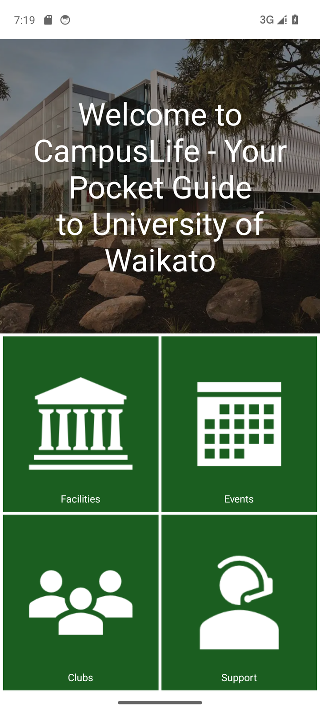
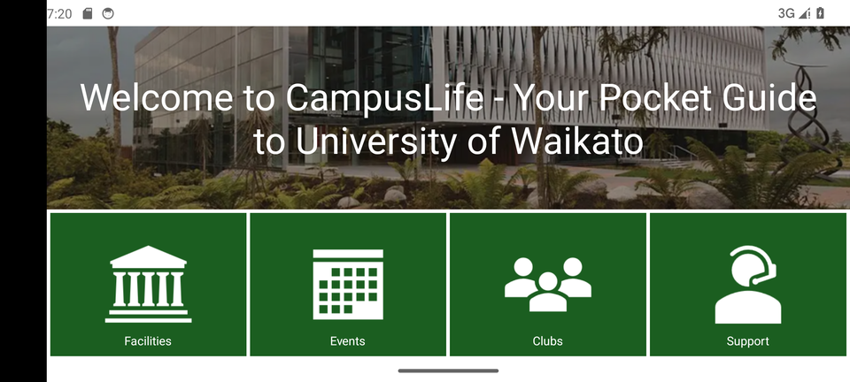
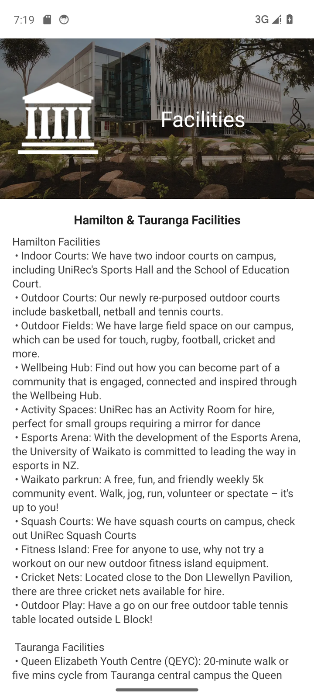

# CampusLife

CampusLife is the "pocket guide" Android application built for **COMPX202/Y05853
Assignment One**. It introduces the four student service areas of the University
of Waikato - **Facilities, Events, Clubs and Support** - on a responsive home
screen and shows the details of the selected area on a second activity.

## Screenshots

<p align="center">
  
  
  
</p>

## Features

* **Responsive home screen.** The screen is built from weighted `LinearLayout`
  bands, rows and tiles; no width or height is fixed in `dp`. The only literal
  size in the layouts is the `40sp` banner title that the brief requires.
* **Orientation aware.** `res/layout/activity_main.xml` shows the four topics in
  a two by two grid, `res/layout-land/activity_main.xml` puts them in a single
  row next to each other.
* **Branding.** The application is called *CampusLife*, uses the green
  `#1B5E20` / light green `#66BB6A` palette and the supplied logo as its
  launcher icon (adaptive icon for API 26+, legacy PNGs for older devices).
* **Button selector.** `res/drawable/button_selector.xml` paints the topic
  buttons green normally and light green while they are pressed.
* **Second activity.** An explicit `Intent` starts `DetailActivity` and carries
  the index of the selected topic; the index is the position of the topic in
  the arrays, so no `if` statement or `switch` case is needed to choose the
  content.
* **Data from resources.** The titles, the detail text and the icon names live
  in `res/values/arrays.xml`; `DetailActivity` reads them and fills the screen.

## Project layout

```
app/src/main/java/nz/ac/waikato/campuslife/
    MainActivity.java      home screen, topic listeners, intent
    DetailActivity.java    detail screen, arrays.xml look-up

app/src/main/res/
    layout/activity_main.xml        portrait home screen
    layout-land/activity_main.xml   landscape home screen
    layout/activity_detail.xml      detail screen
    drawable/                       banner, topic icons, button selector
    values/arrays.xml               assignment dummy data
    values/colors.xml               brand and text colours
    values/dimens.xml               every length used by the layouts
    values/strings.xml              user visible text
    values/themes.xml               Material 3 theme, green primary colour
    mipmap-*/                       CampusLife launcher icon

docs/screenshots/                   screenshots taken on a Pixel 6a emulator
```

## Build and run

Requirements:

* Android Studio (Giraffe or newer) with JDK 17
* Android SDK 34 (compile SDK), minimum SDK 24 (Android 7.0 Nougat)
* Android Gradle Plugin 8.2.2 with Gradle 8.2

Open the project folder in Android Studio, let Gradle sync, then run the `app`
configuration on an emulator or a device. `local.properties` is machine
specific (it points at the local SDK) and is therefore not committed.

## Development history

Each part of the assignment was added, committed and pushed on its own:

| Part | Commit |
| --- | --- |
| A | `Part A: create the AssignmentOne project and add the Gradle wrapper` |
| B | `Part B: build the responsive banner and 2x2 topic grid in XML` |
| C | `Part C: brand the app with the CampusLife colours, logo icon and button selector` |
| D | `Part D: add the landscape layout with the four topics in one row` |
| E | `Part E: show a Toast when a topic tile is clicked` |
| F | `Part F: add the DetailActivity with its banner and scrolling content layout` |
| G | `Part G: pass the selected topic to DetailActivity with an explicit Intent` |
| H | `Part H: populate the detail screen with the title, text and icon from arrays.xml` |
| I | `Part I: document the project and tidy up the code` |

## Notes

* The detail text keeps the bullet style of the supplied `arrays.xml`, so the
  content is shown exactly as provided with the dummy data.
* Content descriptions are set on every image so the app also works with
  TalkBack.
